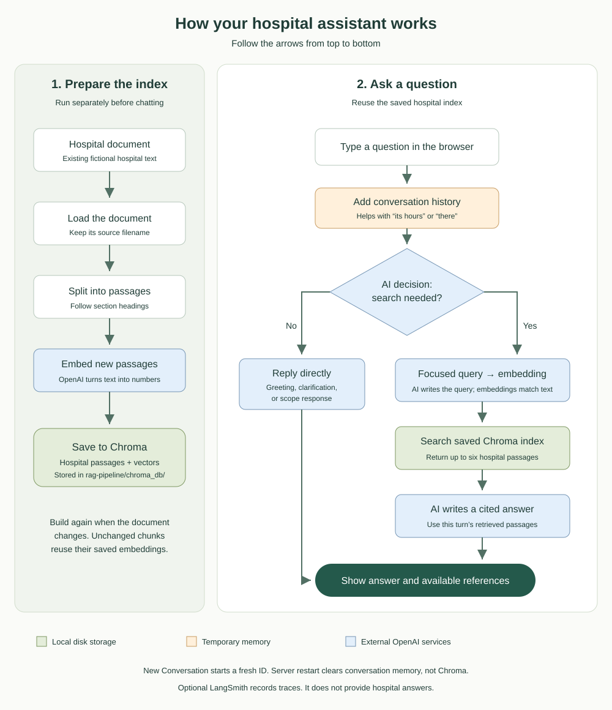

# Hospital Information Assistant — local web UI

A browser interface for the existing fictional hospital RAG project. It uses the original LangGraph agent, OpenAI models, and original Chroma database. The UI does not invent hospital answers or contain a second knowledge base.



Open [the diagram](docs/flowchart.svg) directly if your Markdown viewer does not show images. Once the server runs, [the visual guide](http://127.0.0.1:8000/guide/) displays the diagram as an ordinary image: no Mermaid plugin is required. [Mermaid source](docs/flowchart.mmd) is also available.

## Start here

Follow the complete [local runbook](docs/RUNBOOK.md). The UI now lives inside the existing RAG project:

```text
RAG-Basic-project-Hospital-/
├── README.md
├── rag-pipeline/                 RAG code, data, .env, and chroma_db
└── hospital-ui/                  separate local UI Git repository
```

From `hospital-ui`, on macOS:

```bash
python3 -m venv .venv
source .venv/bin/activate
python -m pip install -r requirements.txt
python -m pip install -r ../rag-pipeline/requirements.txt
cp .env.example .env
python -m uvicorn backend.main:app --host 127.0.0.1 --port 8000 --workers 1
```

Only copy `.env.example` for a new setup; do not overwrite an existing `.env`. Edit `RAG_PROJECT_PATH` if your original repository has a different name or location. Open **http://127.0.0.1:8000**. No Node, React, build step, or paid UI service is required.

Configuration example (placeholders only):

```dotenv
RAG_PROJECT_PATH=../rag-pipeline
CHAT_TIMEOUT_SECONDS=120
# Optional overrides; otherwise reuse the original project's .env:
# OPENAI_API_KEY=your-openai-key
# LANGSMITH_API_KEY=your-langsmith-key
```

Environment precedence is the shell, then `hospital-ui/.env`, then the original RAG `.env`. Existing variables, including empty ones, take precedence. Keys must use their exact uppercase spelling. Credentials are loaded before importing the original graph and never sent to the frontend.

## Project folders

| Folder | Purpose |
| --- | --- |
| `backend/` | FastAPI routes and an adapter that imports the existing graph. |
| `frontend/` | Plain HTML, CSS, and JavaScript served by the same Python server. |
| `tests/` | Mocked backend tests with no model or embedding calls. |
| `docs/` | Local runbook and diagrams visible without Mermaid support. |
| `.venv/` | Ignored Python environment for both projects' dependencies. |
| `output/` | Ignored verification artifacts, when generated. |

`backend/main.py` handles validated chat requests, conversation IDs, safe errors, request reuse, and timeouts. `backend/rag_adapter.py` checks configuration and index availability, then calls `build_graph(enable_memory=True)` from the existing project.

## Behavior

- Each conversation receives its own UUID used as a LangGraph thread ID. Requests within that conversation are serialized; graph calls run in worker threads rather than blocking the async event loop.
- A request UUID prevents duplicate graph execution when a timed-out or disconnected request is retried. Retry rechecks the same job; it does not append another user bubble.
- The HTTP wait defaults to 120 seconds. A timeout does not cancel a running model call or release its conversation lock. Existing model timeouts and retries still apply. A failed graph can have partial state, so start a New Conversation after a model or retrieval failure.
- New Conversation selects a new thread and clears visible messages. Old threads remain in server memory until shutdown. A server restart loses all chats, request caches, and IDs. Refreshing the browser also starts a fresh visible session.
- There are local limits of 200 conversations and 100 requests per conversation to bound request cache growth; restart the server to clear it.
- The existing graph makes at most one search per question. It uses history to resolve follow-ups, but final generation uses current-turn passages. Greetings, clarification, and scope replies may bypass retrieval.
- All reference entries were retrieved; “Cited in answer” means that numeric label appears in the answer. This detects citation labels, not evidence quality. Citation numbers belong only to the current response.
- Output uses safe text nodes, preserves paragraphs and line breaks, and shows literal Markdown punctuation when present. Fictional `.example` addresses remain plain text.

## Testing and limitations

```bash
python -m pytest -q
```

Tests use a mocked graph only. Production has no simulated-answer fallback. See the runbook for manual checks of real answers, missing facts, follow-ups, reset behavior, and disconnection.

This is a local development app with no login, public deployment support, or persistent conversation database. Use one server worker and bind to localhost. The hospital, portal, doctors, and contact information are fictional. There is no live availability or booking tool. Errors and model decisions can still occur, including an unnecessary search for ambiguous questions.

OpenAI model and embedding calls can cost money; even a greeting can call the model. LangSmith tracing is optional and may transmit questions, passages, and answers to that external service. The browser UI helps manual exploration but does not replace the existing saved evaluations (`python -m src.evaluation.evaluate` from `rag-pipeline/`).

The inspected pipeline uses OpenAI (`gpt-6-luna` and `text-embedding-3-small`), not Ollama. Starting Ollama alone will not satisfy its API requirements. This UI does not change providers.

Implementation references: [FastAPI static files](https://fastapi.tiangolo.com/tutorial/static-files/) and [application lifespan](https://fastapi.tiangolo.com/advanced/events/).

See [verification notes](docs/VERIFICATION.md) for what was actually checked. [Complete file contents](docs/COMPLETE_SOURCE.md) provides the full authored source files together, excluding private `.env`, generated environments, and browser artifacts.
