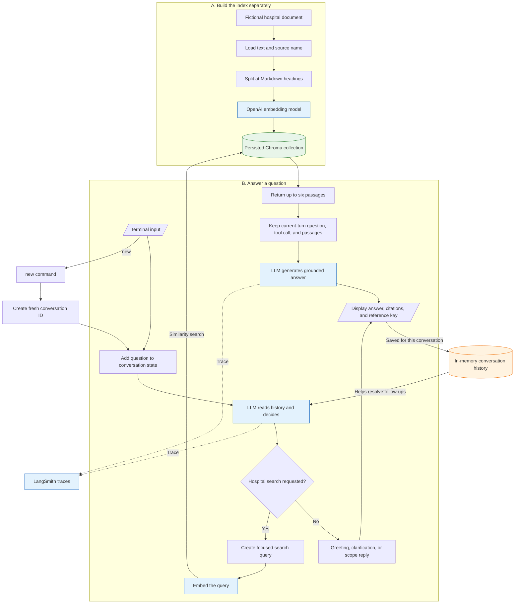

# Application flow

This project has two separate processes: building the searchable index and answering questions. Indexing prepares the hospital document ahead of time. Chatting reuses that saved index; it does not rebuild or re-embed the full document for every question.

## Walkthrough

1. Run `python -m scripts.build_index` separately before chatting. The loader reads `data/raw/hospital_info.txt` and keeps its filename as source metadata.
2. The chunker splits the document at `#`, `##`, and `###` Markdown headings. It records section and subsection names; it does not currently use token-size splitting or overlap.
3. `text-embedding-3-small` converts each new or changed chunk into numbers called an embedding. Chroma saves the chunks and vectors in `chroma_db/`. Stable content hashes prevent unchanged chunks from being embedded again, and obsolete records for that source are removed.
4. Run `python -m app.main` to chat. The terminal creates a conversation ID and sends each question to the LangGraph state.
5. The OpenAI chat model reads the current question and saved conversation messages. It uses history to resolve follow-ups such as “What are its Saturday hours?”
6. The model either answers directly or calls the `search_hospital` tool. Direct answers are intended for greetings, clarification questions, and requests outside the hospital-information scope.
7. For a search, the same chat model produces a focused standalone query. The embedding model converts that query into a vector, and Chroma returns up to six semantically similar passages.
8. The graph calls the chat model again to write the final answer. At this stage, `current_turn_messages()` deliberately supplies only the current question, its tool interaction, and its newly retrieved passages. Older retrieved passages are excluded so citation numbers cannot leak across turns.
9. The terminal prints the answer and a reference key. A citation such as `[1]` means passage 1 from the current response, not a permanent document footnote.
10. Typing `new` creates a fresh conversation ID, so earlier messages are no longer used by the new conversation. Conversation state is held by LangGraph's `InMemorySaver` and disappears when the Python process exits.

## Important distinctions

- **Embeddings find related text.** They do not write the answer.
- **The LLM makes two kinds of decisions.** It decides whether to search and, after retrieval, writes the answer.
- **Chroma persistence is not chat memory.** `chroma_db/` stays on disk between runs; conversation history lives only in the running process.
- **LangSmith observes the run.** When tracing is enabled, it receives traces of graph, tool, and model activity. It does not store the hospital knowledge used to answer questions and does not supply answers.

## Legend

- Green datastore: local persisted index in `chroma_db/`.
- Orange datastore: temporary in-process conversation state.
- Blue components: external OpenAI or LangSmith services.
- Uncolored components: local Python code and files.
